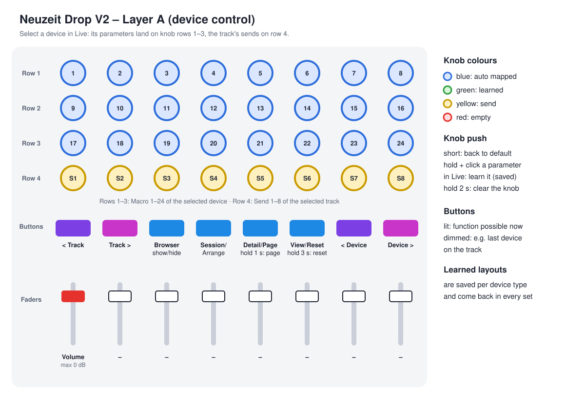
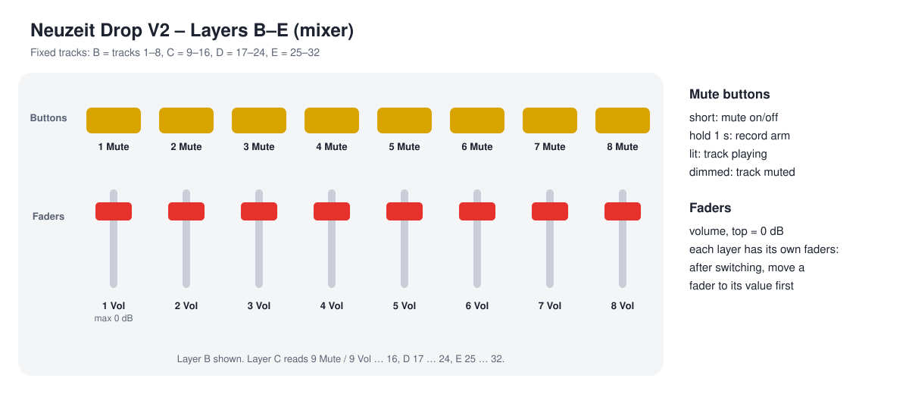

# Neuzeit Drop V2 – Ableton Device Auto Map

An Ableton Live 12 remote script for the **Neuzeit Drop**. Select a device in Live and its parameters land on the Drop's knobs automatically. You can rearrange them by hand, and the Drop remembers your layout for every device of that type, in every set.

*Unofficial: this project is not made or supported by Neuzeit Instruments.*



## Features

- **Auto mapping.** Knob rows 1–3 control the selected device:
  - Racks: their macros.
  - Live devices: Ableton's own parameter banks, as on Push.
  - Max for Live devices and plugins: their parameters in order.
- **Learnable layouts.** Put any parameter on any knob. The layout is saved per device type and comes back every time you use that device.
- **LED rings and colours follow Live.** Blue = auto mapped, green = learned, yellow = send, red = empty.
- **Sends on row 4.** Send 1–8 of the selected track, only as many as the track has.
- **Mixer layers B–E.** Volume, mute and record arm for tracks 1–32.
- **Clip launcher** on the button matrix in Grid mode.
- **Fader caps at 0 dB.** Every volume fader stops at exactly 0 dB in Live when pushed all the way up.

## What you need

- Ableton Live 12. Tested with 12.4 on macOS. It should work the same on Windows, but nobody has tested that yet.
- A Neuzeit Drop with firmware **2.01 or newer**. The knob colours need it.

## Installation

Download **`Neuzeit-Drop_V2.zip`** from the [latest release](../../releases/latest) and unzip it. It contains:

| File / folder | Goes to |
|---|---|
| `Drop_V2/` (the remote script) | your Ableton **User Library → Remote Scripts** folder (see below) |
| `SD Card/Projects/Drop_V2_Projekt.json` (the Drop project) | the **`/Projects`** folder on the Drop's SD card |

### 1. Copy the remote script

Copy the whole `Drop_V2` folder (with the `.py` files inside) to:

| System | Folder |
|---|---|
| **macOS** | `~/Music/Ableton/User Library/Remote Scripts/` |
| **Windows** | `C:\Users\<your name>\Documents\Ableton\User Library\Remote Scripts\` |

If the `Remote Scripts` folder does not exist yet, create it. If you moved your User Library, use that location. In Live it is shown under Settings → Library.

### 2. Load the project on the Drop

1. On the Drop, save your current project **under a different name**, e.g. `My_Old_Project`: MENU → Project → Save. If you save it as `Drop_V2_Projekt`, it overwrites the new file.
2. Put the SD card in your computer and copy `Drop_V2_Projekt.json` into the **`/Projects`** folder. Replace the old file if there is one.
3. Put the card back and load it: MENU → Project → Load → `Drop_V2_Projekt`.
4. Check it: press button 3 above the faders. The display should say **Browser**.

### 3. Set up Live

1. Restart Live.
2. Open Settings → **Link, Tempo & MIDI**.
3. Under *Control Surface*, pick **Drop_V2** in a free slot, and set Input and Output to the Drop's first USB port (on macOS it is called **DROP USB1**).
4. Under *MIDI Ports*, turn on **Remote** for the Drop's input and output.
5. If Neuzeit's own script **Drop_v01** is in another slot, set that slot to *None*. Drop V2 already contains the clip launcher, and with both running every clip button would fire twice.

## Saving your own layout (learning)

The Drop learns from what you click in Live:

1. **Press and hold** a knob on the Drop (row 1–3).
2. With the mouse, **click or move the parameter** you want in Live's device view.
3. **Let go** of the knob. The knob turns green, and the layout is saved.

There is no save button: every change is stored immediately.

- The first time you learn on a device, the automatic layout is copied and only that one knob changes.
- If the parameter was already on another knob, it moves to the new one.
- **Swapping two parameters:** learn A onto knob 1, then learn B onto the knob where you want it.
- **Clear one knob:** hold it for 2 seconds without clicking anything in Live.
- **Back to automatic:** hold button 6 (*View/Reset*) for 3 seconds.

**Which devices share a layout?**
- **Live devices** (Saturator, EQ Three, …) are recognised by type. Your Saturator layout works on every Saturator, even renamed ones, and even if Live runs in another language.
- **Racks, plugins and Max for Live devices** are recognised by type **and name**. Save your racks with their own name, e.g. "My FX Rack", to give each one its own layout.

### Where the layouts are stored

All learned layouts live in one file:

| System | File |
|---|---|
| **macOS** | `~/Music/Ableton/User Library/Drop V2 Profile/profiles.json` |
| **Windows** | `C:\Users\<your name>\Documents\Ableton\User Library\Drop V2 Profile\profiles.json` |

To share your layouts with a friend, send them this file. They put it in the same place and restart Live. Their own layouts in that file get replaced.

Drop V2 only writes this one file. Other controllers such as ROTO-CONTROL or Push keep their own mappings.

## Controls

### Layer A – device control

| Control | Function |
|---|---|
| Knobs row 1–3 | parameters of the selected device (24 per page) |
| Knobs row 4 | Send 1–8 of the selected track (Send A–H in Live) |
| Knob push, short | parameter back to its default value |
| Knob push, hold + click parameter in Live | learn (see above) |
| Knob push, hold 2 s | clear this knob for this device |
| Button 1 / 2 | previous / next track |
| Button 3 | show / hide the Browser |
| Button 4 | switch between Session and Arrangement view |
| Button 5, short | show / hide the Detail view |
| Button 5, hold 1 s | next page of parameters (back to page 1 after the last) |
| Button 6, short | switch between Clip and Device view |
| Button 6, hold 3 s | delete the learned layout of this device |
| Button 7 / 8 | previous / next device on the track |
| Fader 1 | volume of the selected track (top = 0 dB) |
| Fader 2–8 | no function |

The buttons light fully when their function is possible right now. For example, button 8 is dimmed on the last device of a track.

### Layers B–E – mixer



| Layer | Faders 1–8 | Buttons 1–8 |
|---|---|---|
| B "Vol 1-8" | volume of tracks 1–8 | mute tracks 1–8 |
| C "Vol 9-16" | volume of tracks 9–16 | mute tracks 9–16 |
| D "Vol 17-24" | volume of tracks 17–24 | mute tracks 17–24 |
| E "Vol 25-32" | volume of tracks 25–32 | mute tracks 25–32 |

- Short press = mute on/off. **Hold 1 second** = record arm on/off.
- A lit button means the track is playing, a dimmed one means it is muted.
- Track numbers are the numbers in Live's track headers, including group tracks.
- Each layer has its own faders. After switching layers, move a fader to its stored position before it reacts. That is the Drop's normal value catch.
- Layers F–H are left as in DAW Init, for your own MIDI mappings.

### Clip launcher (Grid mode)

Press **GRID** on the Drop (mode DAW, device DAW). A red box in Live shows which 4 tracks × 4 scenes are on the matrix.

| Button | Function |
|---|---|
| top 4 × 4 | launch clips; the colour shows the clip, and whether it is playing, recording or about to start |
| row below | stop the track |
| blue buttons | move the box left / up / down / right |
| Shift + right column | launch the scene |
| Shift + left column (red) | launch the scene at the next DROP of the Drop's cycle |
| Shift + bottom right | stop all clips |

### Ring buttons

When the song is playing, ring buttons 2 / 7 select the next / previous track and 3 / 6 the next / previous device. The Drop only sends them during playback, because they also perform a beat jump.

## Troubleshooting

- **Nothing happens:** check that *Drop_V2* is selected in Live's Control Surface list with the Drop's USB port as input **and** output, and that *Remote* is on for both.
- **Knob colours do not change:** the Drop needs firmware 2.01 or newer, and the `Drop_V2_Projekt` project must be loaded.
- **Something is wrong after updating the script:** restart Live. Live loads remote scripts only at start-up.
- **Live's log** shows what Drop V2 does, in lines marked `(DropV2)`:
  - macOS: `~/Library/Preferences/Ableton/Live 12.x.x/Log.txt`
  - Windows: `C:\Users\<your name>\AppData\Roaming\Ableton\Live 12.x.x\Preferences\Log.txt`

## For developers

The hardware layout lives in one place, `Drop_V2/layout.py`. After changing it:

```bash
python3 tools/make_drop_project.py
python3 -I tests/test_dropv2.py
```

The first command builds the Drop project from Neuzeit's DAW Init (`tools/daw-init.json`). The second runs the tests with stand-ins for Live, so Ableton doesn't need to be running. `python3 tools/make_layout_svgs.py` redraws the diagrams in `docs/`.

A German guide is in [ANLEITUNG.md](ANLEITUNG.md).

## Credits & license

Made by **felay**: [Instagram @_felay_](https://www.instagram.com/_felay_/)

Free to use, change and share under the [MIT License](LICENSE).
